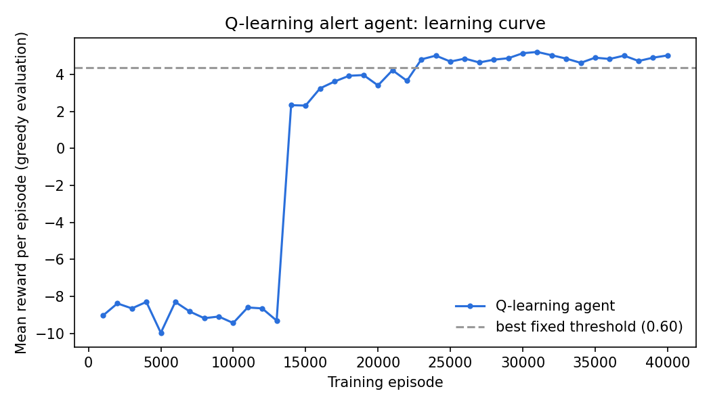
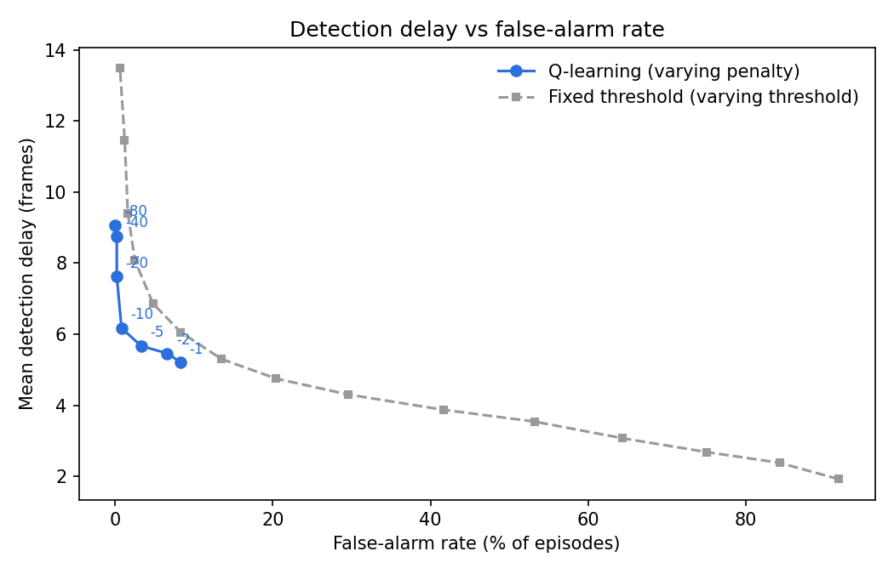

# RL Alert Agent: Learning When to Raise an Alarm

A reinforcement learning agent that learns **when** a noisy threat detector
should raise an alert. It trades off false alarms against slow or missed
detections, a problem every real-world detection system faces.

## The problem

A detector emits a confidence score every frame. Most of the time it sees
background noise, plus occasional spikes from look-alike objects (a phone, a
can). Sometimes a real threat appears and the scores rise over a few frames.

A fixed rule such as "alert when score > 0.5" forces a bad trade-off:

* **Low threshold:** fast detection, but many false alarms.
* **High threshold:** few false alarms, but slow detection.

Instead of hand-tuning that rule, this project lets an RL agent **learn the
alert policy from rewards**.

## How it works

| Piece | What it is |
|---|---|
| **Environment** (`env.py`) | Simulated detector stream: 60 frames per episode, a threat in 50% of episodes, Gaussian noise plus random look-alike spikes |
| **State** | Last 5 scores, discretized as latest score, 5-frame mean, and count of high frames (600 states) |
| **Actions** | `WAIT` or `ALERT` (alert ends the episode) |
| **Rewards** | +10 for a correct alert, minus 0.3 per frame of delay; −10 for a false alarm; −20 for a missed threat; +2 for staying correctly quiet |
| **Agent** (`agents.py`) | Tabular Q-learning with ε-greedy exploration |
| **Baseline** | Fixed-threshold rule on the 3-frame mean, swept from 0.40 to 0.60 |

## Results (5,000 held-out episodes)

| Agent | Mean reward | Detection rate | False alarms | Mean delay (frames) |
|---|---|---|---|---|
| **Q-learning** | **4.99** | **100%** | **0.8%** | **6.2** |
| Threshold 0.60 (best baseline) | 4.36 | 100% | 4.8% | 6.9 |
| Threshold 0.55 | 3.39 | 100% | 13.5% | 5.3 |
| Threshold 0.50 | 1.20 | 100% | 29.6% | 4.3 |

The learned policy cuts false alarms by **about 83%** compared with the best
fixed threshold (4.8% to 0.8%) and still detects threats faster. It learns to
ignore single spikes and wait for a sustained rise, which a single threshold
can't express.



## Run it

```bash
pip install numpy matplotlib
python train.py                  # about 1–2 minutes on a laptop
python train.py --episodes 80000 # longer training
```

Outputs go to `results/`: `metrics.json`, `q_table.npy` and `learning_curve.png`.

## Build steps (if you are recreating this from scratch)

1. **Environment:** write `reset()` and `step(action)` returning
   `(obs, reward, done, info)`. Start with no noise spikes and make sure the
   episode logic is correct before adding difficulty.
2. **Baseline first:** implement the threshold agent and evaluation function.
   You need a number to beat before training anything.
3. **Q-learning:** discretize the state, then apply the update
   `Q[s,a] += α (r + γ max Q[s'] − Q[s,a])`. Decay ε from 1.0 to 0.02.
4. **Evaluate fairly:** measure with exploration off (greedy) on episodes
   with a different random seed from training.
5. **Experiment:** change the false-alarm penalty and watch the policy shift
   between cautious and eager. Record the trade-off.

## Extensions

### Reward sensitivity (`python sweep_penalty.py`)

Q-learning retrained with different false-alarm penalties, all evaluated on the
same base environment. Raising the penalty moves the agent from eager to cautious:

| False-alarm penalty | False alarms | Mean delay (frames) | Detection rate |
|---|---|---|---|
| -1 | 8.3% | 5.21 | 100% |
| -2 | 6.6% | 5.46 | 100% |
| -5 | 3.3% | 5.67 | 100% |
| -10 (default) | 0.8% | 6.17 | 100% |
| -20 | 0.2% | 7.62 | 99.8% |
| -40 | 0.2% | 8.76 | 99.6% |
| -80 | 0.0% | 9.07 | 99.4% |



### Deep RL comparison (`python deep_rl.py`)

`gym_env.py` wraps `AlertEnv` as a Gymnasium environment; PPO and DQN
(Stable-Baselines3, 300k steps, raw scores) are compared with tabular Q-learning.

| Agent | Mean reward | Detection | False alarms | Delay |
|---|---|---|---|---|
| Q-learning | **4.99** | 100% | 0.8% | 6.2 |
| PPO | 4.70 | 100% | 2.8% | 5.95 |
| DQN | 4.43 | 100% | 6.6% | 4.7 |
| Threshold 0.60 | 4.36 | 100% | 4.8% | 6.9 |

On this small problem the tabular agent is as good as or better than the deep
agents, with less compute. Deep agents were not tuned, so this is not a
definitive comparison.

### Harder environment (`python deep_rl.py --config hard`)

Threat strength is drawn from {0.15, 0.25, 0.35, 0.45} per episode and the
background level random-walks (drift). Some threats are now barely above noise.

| Agent | Mean reward | Detection | False alarms | Delay |
|---|---|---|---|---|
| Q-learning | **1.49** | 79.5% | 2.5% | 9.6 |
| Threshold 0.60 (best baseline) | 1.02 | 83.8% | 11.4% | 9.2 |
| DQN | 1.11 | 93.3% | 22.2% | 6.9 |
| PPO | -8.97 | 0% | 0% | none |

Q-learning still beats the best fixed threshold, with far fewer false alarms.
The default PPO collapsed to "never alert" (reward -8.97, exactly what you get
from 50% misses at -20 and 50% quiet episodes at +2). Single seed, so
differences between close agents are within noise.

### Fixing the PPO collapse (`python ppo_fixes.py <variant>`)

Likely cause (hypothesis): early random alerts are almost always false alarms
(-10), so PPO pushes alert probability toward zero and then rarely explores the
late-episode alerts that earn +10. Each fix below was tried alone on the hard
environment (seed 0) and evaluated on the original unshaped rewards:

| PPO variant | Mean reward | Detection | False alarms | Delay |
|---|---|---|---|---|
| Baseline (ent 0.01, 300k steps) | -8.97 | 0% | 0% | none |
| Entropy 0.05 | 1.63 | 84.2% | 7.1% | 8.85 |
| Entropy 0.10 | 1.51 | 82.0% | 5.5% | 9.13 |
| VecNormalize (reward norm.) | 1.75 | 85.4% | 7.8% | 8.54 |
| 1M steps | 1.82 | 86.1% | 7.8% | 8.76 |
| Step cost 0.5/frame once a threat is active (training only) | **1.83** | 86.8% | 8.8% | 8.51 |
| Entropy 0.05 + VecNormalize + step cost | 1.57 | 90.2% | 14.8% | 7.86 |
| *Q-learning (for reference)* | 1.49 | 79.5% | 2.5% | 9.58 |
| *Best threshold (0.60)* | 1.02 | 83.8% | 11.4% | 9.19 |

Every fix escaped the collapse, and all of them beat the best fixed threshold
and Q-learning on mean reward. The fixes are within about 0.3 of each other,
which is likely noise from a single seed, so I would not rank them. Combining
them did not help. Caveat: the exact reason the baseline collapsed is not
verified; the fact that independent fixes all work is consistent with an
exploration problem but does not prove it.

## Next steps

* Multiple seeds with confidence intervals.
* Verify the collapse cause by inspecting PPO's alert probability by score.
* Tune DQN (22% false alarms in the hard environment).
